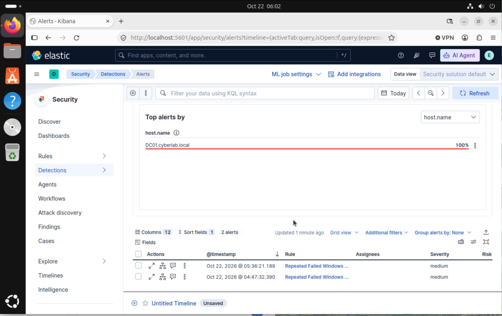

VMware SOC Home Lab

Project Overview

This project documents a hands-on cybersecurity home lab built using VMware Fusion on a MacBook Pro. It provides an isolated environment for practicing system administration, network analysis, security monitoring, troubleshooting, and SOC investigation techniques without affecting my primary operating system.

The project currently includes an Elasticsearch and Kibana monitoring environment, multiple virtual machines, and a controlled SSH authentication-log investigation.

Project Goals

The goals of this project are to:

Build and maintain a practical SOC-style lab environment

Collect and analyze security-related logs

Practice network traffic analysis

Develop incident investigation and documentation skills

Strengthen Linux and Windows administration skills

Troubleshoot authentication, certificate, connectivity, and configuration problems

Lab Environment

The Active Directory detection exercise also used Windows Server DC01 in UTM as the domain controller for cyberlab.local

The lab is hosted in VMware Fusion and includes:

Windows 11 — Endpoint used for security monitoring and testing

Ubuntu Linux — Hosts Elasticsearch and provides Linux authentication logs

Kali Linux — Authorized security-testing and analysis system

Security Tools

Elasticsearch — Stores, searches, and analyzes security-related data

Kibana — Provides a web interface for exploring and visualizing Elasticsearch data

Docker — Runs and manages the Kibana container

Wireshark — Captures and analyzes network traffic

VMware Fusion — Creates and manages the virtualized lab environment

Architecture

The virtual machines communicate within a controlled VMware network. In the SSH authentication exercise, Kali Linux acted as the authorized test system and Ubuntu acted as the monitored target.

System

Role

Lab IP address

Kali Linux

Authorized test source

192.168.232.130

Ubuntu Linux

SSH target and log source

192.168.232.128

Windows 11

Endpoint and Wireshark system

Dynamic lab address

The complete architecture diagram is available in the Diagram folder.

Elasticsearch Installation and Verification

Elasticsearch was installed on the Ubuntu virtual machine as the data-storage and search component of the monitoring environment.

The installation was verified by:

Checking the Elasticsearch system service.

Confirming that the service was active (running).

Testing the local Elasticsearch HTTPS endpoint.

Authenticating with the elastic account.

Confirming that the API returned cluster and version information.

Screenshots showing the installation and verification process are available in the Screenshots folder.

Kibana Deployment and Troubleshooting

Kibana was deployed as a Docker container and connected to Elasticsearch. During configuration, Kibana could not connect correctly because the Elasticsearch certificate path was mounted as a directory instead of the required certificate file.

Troubleshooting Process

Reviewed the Kibana container status and logs.

Identified a problem with the certificate-authority mount.

Verified the location of Elasticsearch's http_ca.crt certificate.

Corrected the Docker volume mapping so it referenced the certificate file.

Configured Kibana to use the correct Elasticsearch host and certificate authority.

Added the required Elasticsearch authentication settings.

Restarted the Kibana container.

Confirmed that the container remained running and that Kibana was reachable on port 5601.

Result

Kibana successfully connected to Elasticsearch after the certificate path and authentication configuration were corrected. This exercise strengthened my understanding of Docker volume mapping, TLS certificates, authentication, container logs, and service connectivity.

SSH Authentication Log Analysis

Objective

The objective was to generate controlled SSH authentication activity and investigate the resulting Ubuntu logs as a SOC analyst would examine a possible login incident.

Activity Performed

Verified network connectivity between Kali Linux and Ubuntu.

Attempted an authorized SSH login from Kali Linux to Ubuntu.

Used the test username soc-test-user.

Entered an incorrect password three times to generate failed authentication events.

Reviewed Ubuntu's /var/log/auth.log file.

Identified and recorded the source IP, target IP, username, timestamps, number of attempts, and authentication outcome.

Investigation Findings

Field

Finding

Event type

Failed SSH authentication

Source system

Kali Linux

Source IP

192.168.232.130

Target system

Ubuntu Linux

Target IP

192.168.232.128

Attempted username

soc-test-user

Number of failures

3

Approximate time

22:59–23:00

Investigation source

/var/log/auth.log

Classification

Authorized lab testing

Analysis

The repeated failures from one source IP could resemble a small password-guessing attempt. However, the activity was expected, limited to three attempts, and performed by me in an isolated lab. It was therefore classified as authorized testing with no escalation required.

In a production SOC, similar unexpected activity would require additional investigation, including reviewing the source reputation, searching for other affected accounts or systems, checking whether any later login succeeded, and determining whether containment or escalation was necessary.

Wireshark

Wireshark is used in this lab for:

Packet capture

Protocol analysis

Network troubleshooting

Identifying unusual network activity

Understanding communication between lab systems

Skills Developed

VMware virtualization

Linux and Windows administration

Elasticsearch and Kibana fundamentals

Docker container deployment and troubleshooting

TLS certificate configuration

Authentication troubleshooting

SSH log analysis

Source and target identification

Security-event classification

Network traffic analysis with Wireshark

SOC investigation methodology

Technical documentation

## Failed Windows Logon Detection

### Objective
Detect repeated Windows failed logons (Event ID 4625) in the Active Directory lab and generate a Kibana alert.

### Rule configuration
- Query: `event.code: "4625"`
- Threshold: 5 or more matching events
- Grouped by: `host.name`
- Schedule: every 5 minutes
- Additional look-back: 1 day
- Severity: Medium

### Validation
I generated failed logons in the lab and confirmed that the events triggered the rule. Kibana displayed two medium severity alerts for `DC01.cyberlab.local`, at 4:47 AM and 5:36 AM on October 22, 2026.

Project Documentation

Diagram — Lab architecture

- [Project notes](Note/) — installation, troubleshooting, lessons learned, and analysis notes
  
Screenshots — Evidence of installation, configuration, troubleshooting, and analysis

Sensitive information, including passwords and authentication credentials, is excluded or redacted from all screenshots.

Project Status

Completed

Windows failed-logon detection and Kibana alert validation

VMware Fusion lab environment

Windows 11, Ubuntu Linux, and Kali Linux virtual machines

Wireshark setup

Elasticsearch installation and API verification

Kibana Docker deployment

Kibana certificate and authentication troubleshooting

Kali-to-Ubuntu network connectivity

Controlled SSH authentication test

Ubuntu authentication-log investigation

Initial GitHub documentation

Next Steps

Install and configure Filebeat

Send Ubuntu authentication logs to Elasticsearch

Investigate the SSH events in Kibana

Create a Kibana visualization or detection rule for repeated failed SSH logins

Add investigation screenshots and a detailed incident report

Disclaimer
This project was completed in a controlled home laboratory for educational and cybersecurity skill-development purposes. All testing was authorized and limited to systems that I own and manage.
