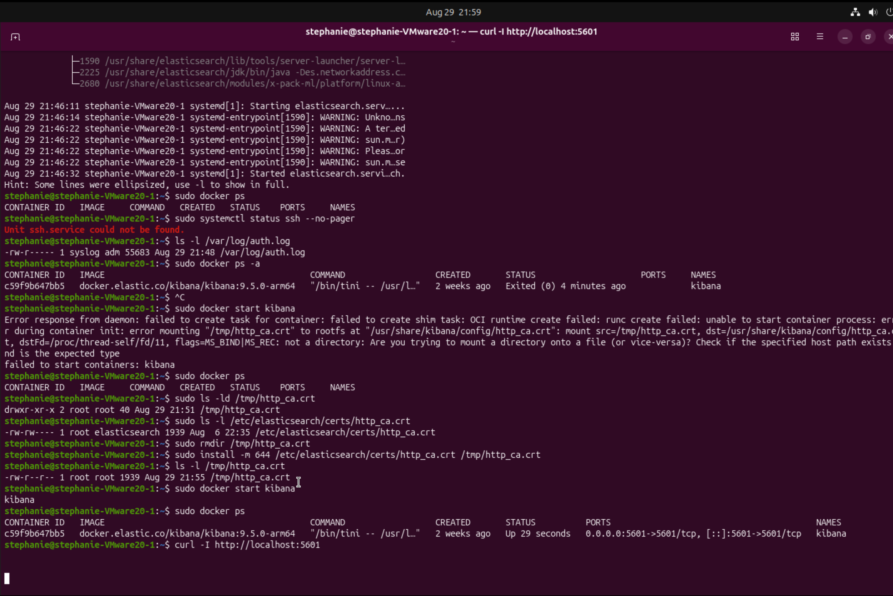
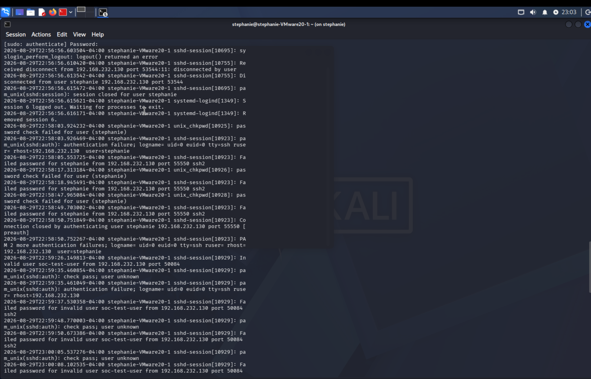
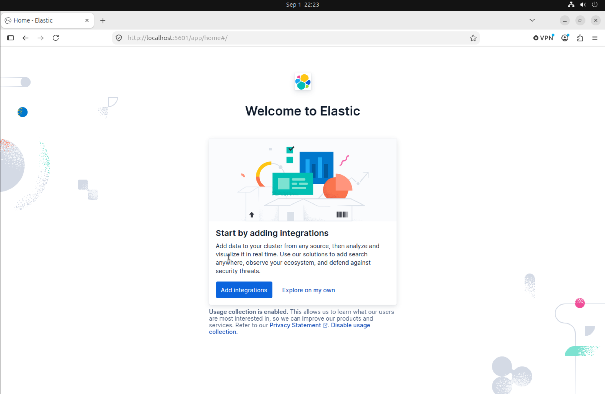

# SSH Authentication Log Analysis

## Project Summary

This exercise documents a controlled SSH authentication test performed in my VMware SOC home lab. I generated three failed SSH login attempts from Kali Linux and investigated the resulting authentication events on Ubuntu Linux.

The purpose was to practice how a SOC analyst identifies the source, target, username, time, outcome, and context of suspicious authentication activity.

---

## Authorization and Scope

All activity was performed in an isolated home lab on virtual machines that I own and manage. The failed login attempts were intentional and authorized. No external or production systems were targeted.

---

## Lab Systems

| System | Purpose | IP address |
|---|---|---|
| Kali Linux | Authorized SSH test source | `192.168.232.130` |
| Ubuntu Linux | SSH target and authentication-log source | `192.168.232.128` |

### Supporting Technologies

- VMware Fusion
- Ubuntu Linux
- Kali Linux
- SSH
- Elasticsearch
- Kibana
- Docker

---

## Exercise Objectives

- Verify connectivity between Kali Linux and Ubuntu
- Generate controlled failed SSH authentication events
- Locate the events in the Ubuntu authentication log
- Identify important investigation details
- Determine whether the activity required escalation
- Document the investigation in a repeatable format

---

## Part 1: Kibana Troubleshooting

Before performing the log investigation, I repaired the Kibana configuration in my monitoring environment.

### Problem Observed

Kibana was not connecting correctly to Elasticsearch. The Elasticsearch certificate path used by the Kibana Docker container was mapped as a directory rather than as the required `http_ca.crt` certificate file. Kibana also required valid Elasticsearch authentication settings.

### Investigation Process

I checked the Kibana container and reviewed its recent log messages:

```bash
sudo docker ps
sudo docker logs kibana --tail 50
```

- `docker ps` showed whether the Kibana container was running and whether port `5601` was mapped.
- `docker logs` displayed recent application messages and configuration errors from the container.

I then verified that the Elasticsearch certificate existed as a file on Ubuntu:

```bash
sudo ls -l /etc/elasticsearch/certs/http_ca.crt
```

### Resolution

I corrected the Docker certificate mapping so that Kibana referenced the actual `http_ca.crt` file. I also configured the correct Elasticsearch host, certificate authority, and authentication values. After restarting the container, I verified that:

- The Kibana container remained running
- Port `5601` was available
- Kibana could authenticate to Elasticsearch
- The Kibana interface was accessible

### Troubleshooting Lesson

A path can have the correct name but still be the wrong object type. In this case, the path was treated as a directory when Kibana required a certificate file. Container logs and file-type verification helped isolate the cause.

---

## Part 2: Network Connectivity Test

Before attempting SSH, I confirmed that Kali Linux could reach Ubuntu:

```bash
ping 192.168.232.128
```

Receiving replies confirmed that the systems could communicate across the VMware lab network. This did not prove that SSH authentication would succeed, but it confirmed basic IP connectivity.

---

## Part 3: Controlled SSH Authentication Test

From Kali Linux, I attempted to connect to the Ubuntu system using the lab username:

```bash
ssh soc-test-user@192.168.232.128
```

I intentionally entered an incorrect password three times. This generated failed authentication events for investigation.

### Expected Evidence

Each failed attempt was expected to record information such as:

- Authentication result
- Attempted username
- Source IP address
- SSH service
- Date and time

---

## Part 4: Ubuntu Log Investigation

On Ubuntu, I reviewed the authentication log:

```bash
sudo tail -n 50 /var/log/auth.log
```

To narrow the results to failed authentication activity, a filter such as the following can be used:

```bash
sudo grep "Failed password" /var/log/auth.log
```

`tail` displays recent log entries, while `grep` searches for entries containing the specified text.

---

## Investigation Findings

| Investigation field | Finding |
|---|---|
| Event type | Failed SSH authentication |
| Source system | Kali Linux |
| Source IP | `192.168.232.130` |
| Target system | Ubuntu Linux |
| Target IP | `192.168.232.128` |
| Attempted username | `soc-test-user` |
| Number of failures | 3 |
| Approximate time | 22:59–23:00 |
| Log source | `/var/log/auth.log` |
| Activity status | Expected and authorized |

---

## SOC Analysis

Three failed SSH attempts from one source could be an early indicator of password guessing. A SOC analyst should not classify an event using the failure count alone; the surrounding context must also be considered.

In this investigation:

- The source system belonged to the lab
- The activity was intentionally generated
- The test was limited to three attempts
- The source and target IP addresses matched the planned exercise
- No unauthorized access occurred

### Final Classification

**Authorized lab testing — no escalation required.**

In a production environment, unexpected repeated failures would require further investigation. Relevant checks would include:

- Whether the source IP is known or trusted
- Whether other accounts or systems were targeted
- Whether a successful login followed the failures
- Whether the activity continued over a longer period
- Whether the account owner recognized the activity
- Whether containment or escalation was required

---

## Evidence collected
### Ubuntu SSH Authentication Logs



### Kibana Container Status



### Working Kibana Interface


---

## Challenges and Resolutions

| Challenge | Resolution |
|---|---|
| Kibana could not use the certificate correctly | Verified the certificate path and corrected the Docker file mapping |
| Kibana required Elasticsearch authentication | Added the proper authentication configuration |
| Needed to verify cross-VM communication | Used `ping` before testing SSH |
| Authentication logs contained many entries | Focused on recent entries and filtered for failed-password events |
| Needed to distinguish an attack from a test | Compared the evidence with the authorized activity and lab scope |

---

## Skills Demonstrated

- Linux authentication-log analysis
- SSH fundamentals
- Source and target IP identification
- Security-event triage and classification
- Docker container troubleshooting
- TLS certificate-path troubleshooting
- Elasticsearch and Kibana fundamentals
- Network-connectivity testing
- Evidence collection
- Technical report writing

---

## Lessons Learned

This project taught me that effective investigation requires both technical evidence and context. A failed login event may appear suspicious, but its meaning depends on the source, timing, frequency, affected account, and whether the activity was authorized.

I also learned to troubleshoot monitoring tools systematically by reviewing service status, container logs, file paths, authentication settings, and network ports instead of changing several configurations at once.

---

## Next Phase

The current exercise examined the events directly in Ubuntu's `/var/log/auth.log`. The next phase of the project will:

1. Install and configure Filebeat.
2. Send Ubuntu authentication logs to Elasticsearch.
3. Locate the failed SSH events in Kibana.
4. Create a visualization or detection rule for repeated authentication failures.
5. Compare host-level log analysis with centralized SIEM analysis.

---

## Conclusion

I successfully generated and investigated controlled failed SSH authentication events in my VMware SOC home lab. I identified the source IP, target IP, attempted username, timestamps, number of failures, and event outcome. Based on the known lab context, I correctly classified the events as authorized testing while documenting how similar unexpected activity should be handled in a production SOC.
